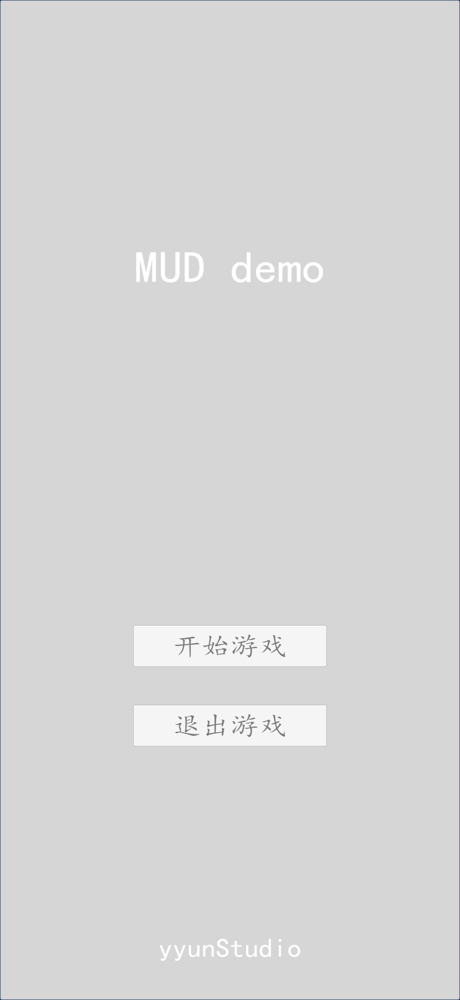
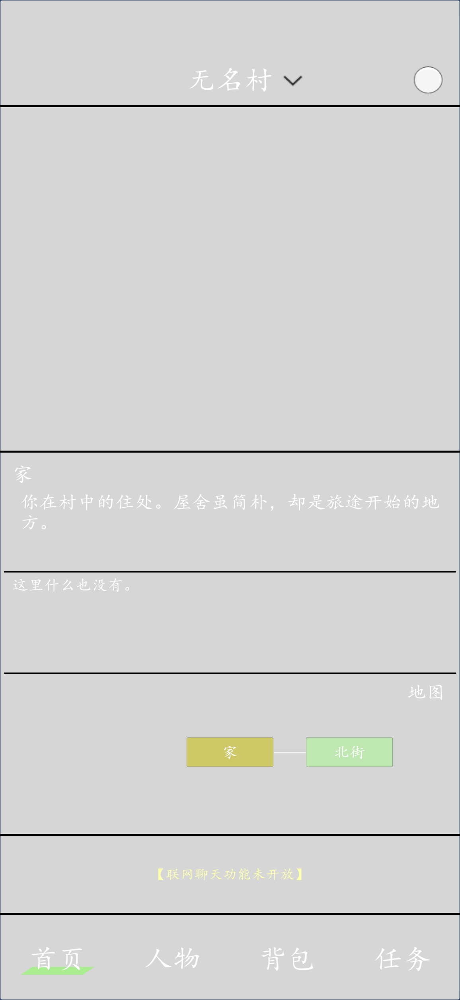
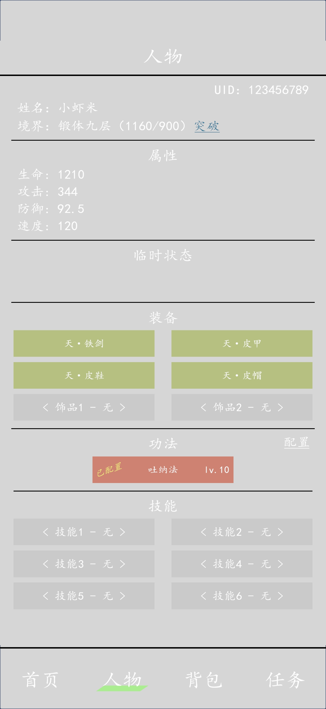
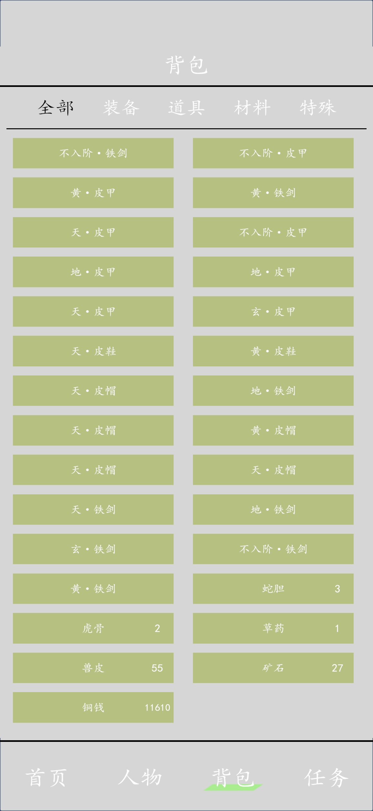
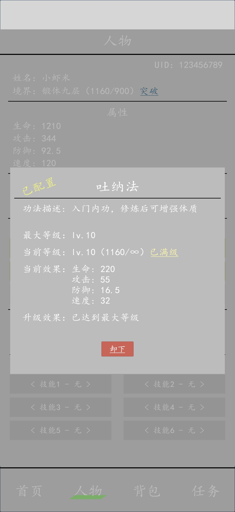
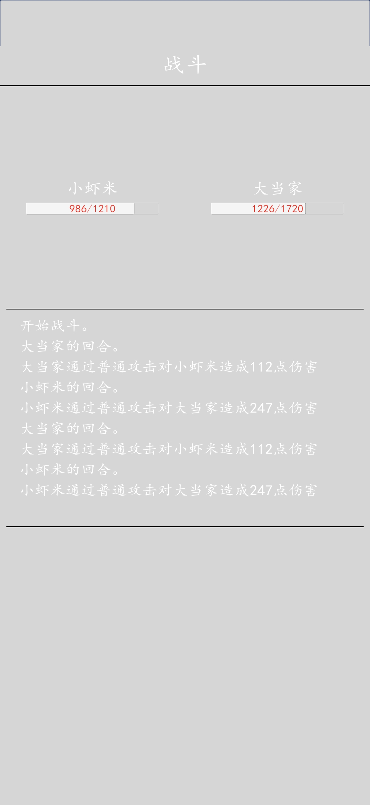
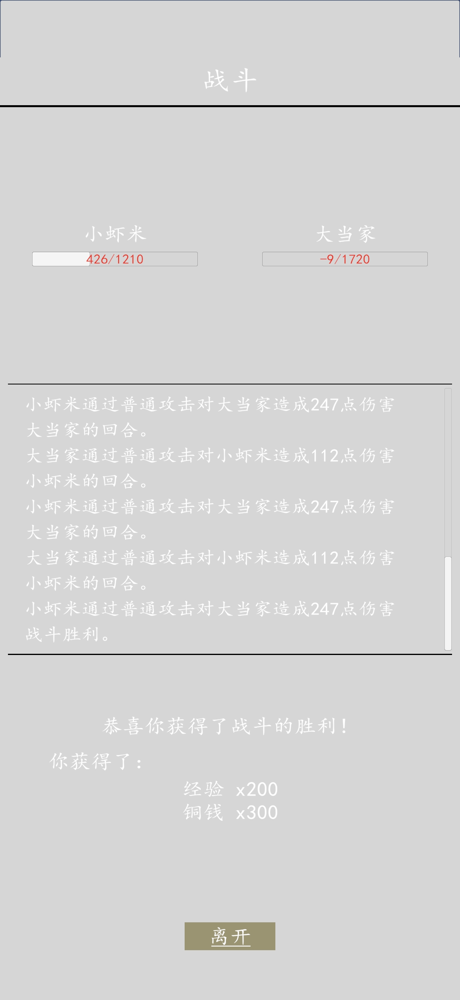
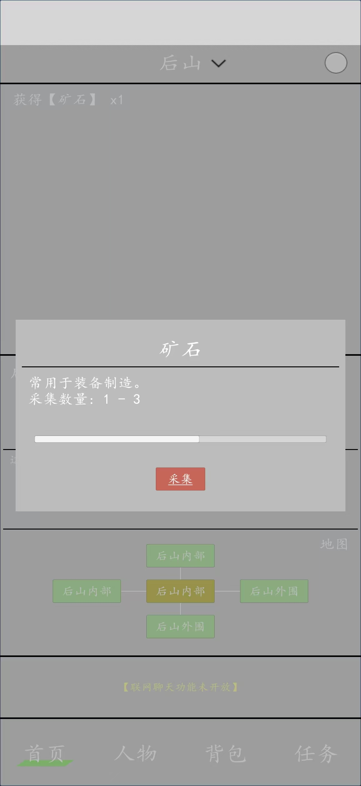
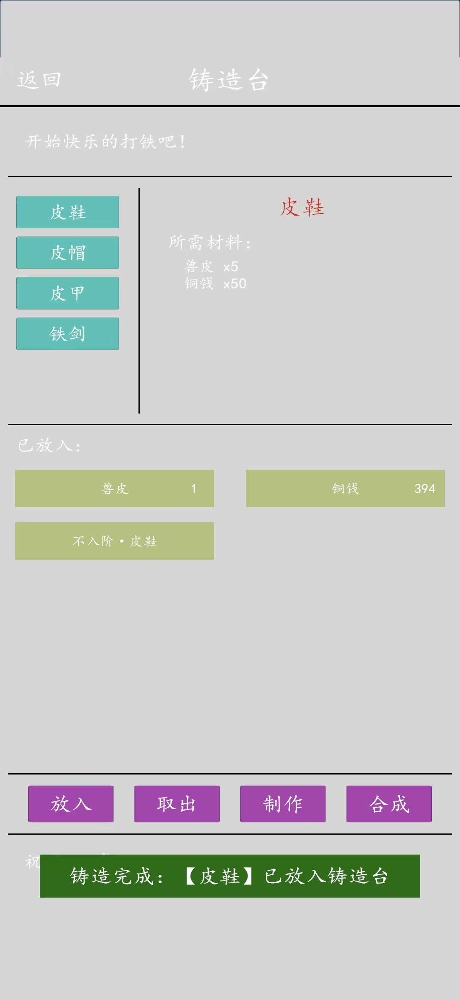

# 无名之地

## 独立开发 | Unity 文字游戏 Demo | 2026.8 – 2026.10

一个单机文字 MUD：**打怪 → 掉材料 → 造装备 → 变强 → 推主线**。
玩法、数值、文案、程序全部由我一个人完成 —— 属性与成长框架、战斗公式、经济闭环、配置表，以及把这些配置跑起来的 C# 脚本。

- **项目 demo 见 [Releases](../../releases)**（Android 安装包，约 65 MB，安装需允许"未知来源应用"）
- 技术：Unity + C#，ScriptableObject 配置表驱动，自研配置编辑器与导出工具

---

## demo 截图

<table>
  <tr>
    <td align="center" width="33%"> <b>主菜单</b></td>
    <td align="center" width="33%"> <b>首页 · 地点描述与地图</b> 节点式地图，点击相邻地点移动</td>
    <td align="center" width="33%"> <b>人物面板</b> 四维属性 / 6 装备槽 / 1 功法槽 / 6 技能槽</td>
  </tr>
  <tr>
    <td align="center" width="33%"> <b>背包</b> 装备 / 材料 / 铜钱分栏，材料即经济产出</td>
    <td align="center" width="33%"> <b>任务</b> 日常任务的目标计数与达成条件</td>
    <td align="center" width="33%"> <b>功法详情</b> 按 Base + Increment×(Lv−1) 线性成长</td>
  </tr>
  <tr>
    <td align="center" width="33%"> <b>剧情对话</b> 节点交互类型之一，对话可触发战斗或给予</td>
    <td align="center" width="33%"> <b>回合制战斗</b> 减法公式 max(1, ATK−DEF)，日志逐回合结算</td>
    <td align="center" width="33%"> <b>战斗结算</b> 经验与铜钱掉落，直接进入成长曲线</td>
  </tr>
  <tr>
    <td align="center" width="33%"> <b>采集</b> 随机数量 1–3 + 采集耗时进度条</td>
    <td align="center" width="33%"> <b>铸造台</b> 图纸 + 5 材料 + 50 铜钱 → 1 件装备</td>
    <td align="center" width="33%"> <b>草药铺</b> 以材料换成品，构成经济闭环的消耗端</td>
  </tr>
</table>

---

## 数值设计概要

| 模块 | 设计 |
|---|---|
| **属性框架** | 最终属性 = 等级基础 + 装备 + 功法 + 临时状态 + 额外属性；四维 HP / ATK / DEF / SPD |
| **等级** | 境界（锻体九层 → 练气）× 小境界，ID = 境界 × 10 + 层数；经验 100 起、每层 +100 |
| **成长** | 属性每层 +30 HP / +10 ATK / +5 DEF / +5 SPD；练气一层一次性跃迁 |
| **战斗** | 减法公式 `max(1, ATK − DEF)`；SPD 决定先手，同速 50% 随机；1 秒 / 回合 |
| **经济** | 铜钱 ↔ 银两（1000 : 1）；怪物掉落 50–300；图纸 500；制造 5 材料 + 50 铜钱 |
| **内容量** | 10 级 / 9 种敌人 / 4 家商店共 18 项商品 / 8 条任务 / 68 个地图节点 / 5 大区域 |

> 配置完成后，我用 Python 对 **10 级 × 9 种敌人共 90 组**战斗组合做了全量推演，
> 发现其中 21 组伤害被压到保底 1 点、新手首战在设计上必败，并据此对比减法公式与减伤率公式给出修正方案。
> 完整推演过程与数据表可以面聊时提供。

---

## 关于

- 开发者：刘赟（[@yyun2003](https://github.com/yyun2003)）
- 美术资源使用 AI 生成与免费素材，代码、数值与文案均为原创
